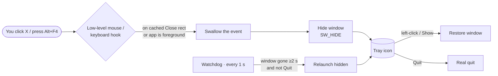

<div align="center">


# Grok Bot Background Helper

**Close the window, keep the app. A tiny Windows tray helper that keeps the Grok Bot desktop app running in the background.**

[](#quick-start)
[](LICENSE)
[-512BD4)](#quick-start)
[](#quick-start)
[](#disclaimer)

**English** · [繁體中文](README.zh-TW.md)

</div>

---

## Why

On Windows, the Grok Bot desktop app (Electron) quits when its last window closes, and there's no tray / "run in background" option. Once it's gone, the bot can't reach your PC anymore. Patching `app.asar` doesn't work either: Electron's ASAR-integrity and `OnlyLoadAppFromAsar` fuses are on, so any change stops the app from launching.

This helper fixes it **from the outside**. No app files are modified.

## Demo

> 🎬 Demo GIF coming soon (`assets/demo.gif`).

## Features

| | Feature | Details |
|---|---|---|
| ❌➜🙈 | **X / Alt+F4 hides instead of quits** | Clicks on the Close button and Alt+F4 are intercepted; the window is hidden (also off the taskbar) |
| 🖱️ | **One-click restore** | Left-click the tray icon to bring the window back; right-click for the menu |
| 🐕 | **Watchdog** | If the app dies unexpectedly, it's relaunched hidden after ~2 s (never after you choose *Quit*) |
| 🖥️ | **DPI aware** | Per-monitor V2, works at 125% / 150% / multi-monitor setups |
| 🧩 | **Zero dependencies** | Compiled with the `csc.exe` that ships with Windows (.NET Framework 4.x) |
| 🔓 | **No admin rights** | Installs to `%LOCALAPPDATA%` + a Startup-folder shortcut |
| ⚙️ | **Configurable** | `helper.ini` lets you point it at another Electron app |
| 📝 | **Bounded logs** | `helper.log` rolls over at 256 KB |

## How it works



- Every second the helper finds the main window (title + `Chrome_WidgetWin_1` class + process name) and locates the Close button with `WM_NCHITTEST` → `HTCLOSE`, using the window's real DPI.
- The hooks only read the cached rectangle and post the hide to the UI thread, so Windows doesn't silently remove them. If a hook is lost, it's reinstalled on the next tick.
- The watchdog won't start a second copy while the launched process is alive, a top-level window of the app exists, or an app process is younger than 20 s.

## Quick start

Requirements: Windows 10/11 (the built-in .NET Framework 4.x is enough).

```powershell
git clone https://github.com/stantheman0128/grokbot-background-helper
cd grokbot-background-helper\windows
powershell -ExecutionPolicy Bypass -File .\build.ps1     # builds GrokBotTray.exe
powershell -ExecutionPolicy Bypass -File .\install.ps1   # %LOCALAPPDATA%\GrokBotTray + Startup shortcut, then starts it
```

Uninstall:

```powershell
powershell -ExecutionPolicy Bypass -File .\uninstall.ps1
```

## Configuration

`helper.ini` (next to the exe; `%ENV%` variables are expanded):

| Key | Default | Meaning |
|---|---|---|
| `AppName` | `Grok Bot` | Tray tooltip and menu label |
| `ExePath` | `%LOCALAPPDATA%\Programs\Grok Bot\Grok Bot.exe` | What the watchdog launches |
| `WindowTitle` | `Grok Bot` | Main window title to match |
| `ProcessName` | `Grok Bot` | Process name (no `.exe`) |
| `WindowClass` | `Chrome_WidgetWin_1` | Window class (Electron default) |

## FAQ

<details><summary><b>Does it modify the Grok Bot app?</b></summary>
No. It only watches the window from outside. App updates won't overwrite it.
</details>

<details><summary><b>Why not just patch <code>app.asar</code>?</b></summary>
The app's Electron integrity fuses are enabled; a modified archive won't launch.
</details>

<details><summary><b>My antivirus complains.</b></summary>
Global low-level hooks are a common heuristic trigger. The source is ~340 lines in <code>windows/GrokBotTray.cs</code>; build it yourself and review it.
</details>

<details><summary><b>How do I really quit the app?</b></summary>
Right-click the tray icon → <b>Quit Grok Bot</b>. The watchdog won't restart it. <b>Exit helper</b> stops the helper itself.
</details>

<details><summary><b>Can I use it with other apps?</b></summary>
Electron apps with a standard title bar usually work by editing <code>helper.ini</code>. One app per helper instance for now.
</details>

<details><summary><b>Something isn't working.</b></summary>
Check <code>helper.log</code> and <code>status.txt</code> in <code>%LOCALAPPDATA%\GrokBotTray</code> and open an issue.
</details>

## Limitations

- Relies on title-bar hit-testing; future app UI changes may need adjustments.
- Only one window of one target app is handled per instance.
- If the app renames its exe or window title, update `helper.ini`.
- Windows only (on macOS, closing the window doesn't quit the app anyway).

## Disclaimer

Unofficial community tool. Not affiliated with, endorsed by, or sponsored by xAI / SpaceXAI. "Grok" is a trademark of its respective owner and is used here only to describe compatibility. Use at your own risk.

## License

[MIT](LICENSE)
