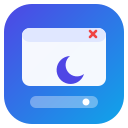
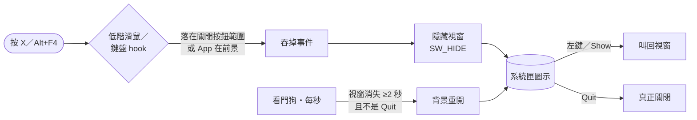

<div align="center">



# Grok Bot Background Helper

**關掉視窗，App 照樣在。讓 Grok Bot 桌面版在 Windows 背景常駐的小型系統匣工具。**

[](#快速開始)
[](LICENSE)
[-512BD4)](#快速開始)
[](#快速開始)
[](#免責聲明)

[English](README.md) · **繁體中文**

</div>

---

## 為什麼需要

Windows 上的 Grok Bot 桌面版（Electron）關掉最後一個視窗就會整個結束，也沒有系統匣或「背景執行」選項，關掉後 Bot 就沒辦法再操作你的電腦。改 `app.asar` 也行不通：App 開了 ASAR 完整性檢查和 `OnlyLoadAppFromAsar` 等 Electron fuse，改檔就打不開。

這個小工具**從外部**解決問題，完全不修改 App 檔案。

## 示範

> 🎬 示範 GIF 準備中（`assets/demo.gif`）。

## 功能

| | 功能 | 說明 |
|---|---|---|
| ❌➜🙈 | **按 X／Alt+F4 只隱藏** | 攔截關閉按鈕與 Alt+F4，視窗改為隱藏（工作列也不顯示） |
| 🖱️ | **一鍵叫回** | 左鍵點系統匣圖示叫回視窗，右鍵開選單 |
| 🐕 | **看門狗** | App 意外結束約 2 秒後自動在背景重開（你選 *Quit* 時不會） |
| 🖥️ | **支援高 DPI** | Per-Monitor V2，125%／150%、多螢幕都可用 |
| 🧩 | **零相依** | 用 Windows 內建 .NET Framework 4.x 的 `csc.exe` 編譯 |
| 🔓 | **不需系統管理員** | 安裝到 `%LOCALAPPDATA%`，加入「啟動」資料夾捷徑 |
| ⚙️ | **可設定** | 透過 `helper.ini` 指向其他 Electron App |
| 📝 | **紀錄有上限** | `helper.log` 超過 256 KB 自動換檔 |

## 運作方式



- 每秒用標題、`Chrome_WidgetWin_1` 類別與程序名稱找到主視窗，並依視窗實際 DPI 用 `WM_NCHITTEST` → `HTCLOSE` 找出關閉按鈕位置。
- Hook 只讀快取的範圍、把隱藏動作丟回 UI 執行緒，避免太慢被 Windows 悄悄移除；Hook 若遺失，下一秒自動重裝。
- 剛啟動的程序還在、已有 App 視窗，或 App 程序未滿 20 秒時，看門狗不會再多開一份。

## 快速開始

需求：Windows 10/11（內建 .NET Framework 4.x 即可）。

```powershell
git clone https://github.com/stantheman0128/grokbot-background-helper
cd grokbot-background-helper\windows
powershell -ExecutionPolicy Bypass -File .\build.ps1     # 編譯 GrokBotTray.exe
powershell -ExecutionPolicy Bypass -File .\install.ps1   # 安裝到 %LOCALAPPDATA%\GrokBotTray、加入開機啟動並執行
```

解除安裝：

```powershell
powershell -ExecutionPolicy Bypass -File .\uninstall.ps1
```

## 設定

`helper.ini`（放在 exe 旁，支援 `%ENV%` 變數）：

| 鍵 | 預設值 | 說明 |
|---|---|---|
| `AppName` | `Grok Bot` | 系統匣提示與選單名稱 |
| `ExePath` | `%LOCALAPPDATA%\Programs\Grok Bot\Grok Bot.exe` | 看門狗要啟動的程式 |
| `WindowTitle` | `Grok Bot` | 要比對的主視窗標題 |
| `ProcessName` | `Grok Bot` | 程序名稱（不含 `.exe`） |
| `WindowClass` | `Chrome_WidgetWin_1` | 視窗類別（Electron 預設） |

## 常見問題

<details><summary><b>會改到 Grok Bot App 嗎？</b></summary>
不會，只從外部監看視窗，App 更新也不會蓋掉它。
</details>

<details><summary><b>為什麼不直接改 <code>app.asar</code>？</b></summary>
App 開了 Electron 完整性 fuse，改過的檔案無法啟動。
</details>

<details><summary><b>防毒軟體跳警告？</b></summary>
全域低階 hook 常被啟發式偵測標記。原始碼只有約 340 行（<code>windows/GrokBotTray.cs</code>），可自行檢視後編譯。
</details>

<details><summary><b>要怎麼真的關掉 App？</b></summary>
右鍵系統匣圖示 → <b>Quit Grok Bot</b>，看門狗不會重開。<b>Exit helper</b> 則是結束小工具本身。
</details>

<details><summary><b>可以用在其他 App 嗎？</b></summary>
有標準標題列的 Electron App 通常改 <code>helper.ini</code> 就能用。目前一個小工具實例只管一個 App。
</details>

<details><summary><b>出問題了？</b></summary>
查看 <code>%LOCALAPPDATA%\GrokBotTray</code> 裡的 <code>helper.log</code> 和 <code>status.txt</code>，並開 issue。
</details>

## 限制

- 依賴標題列 hit-test，App 介面改版可能需要調整。
- 每個實例只處理一個 App 的一個視窗。
- App 若改了 exe 或視窗標題，請更新 `helper.ini`。
- 僅支援 Windows（macOS 關視窗本來就不會結束 App）。

## 免責聲明

非官方社群工具，與 xAI／SpaceXAI 無關，也未獲其背書或贊助。「Grok」為其權利人之商標，此處僅用於說明相容性。使用風險自負。

## 授權

[MIT](LICENSE)
